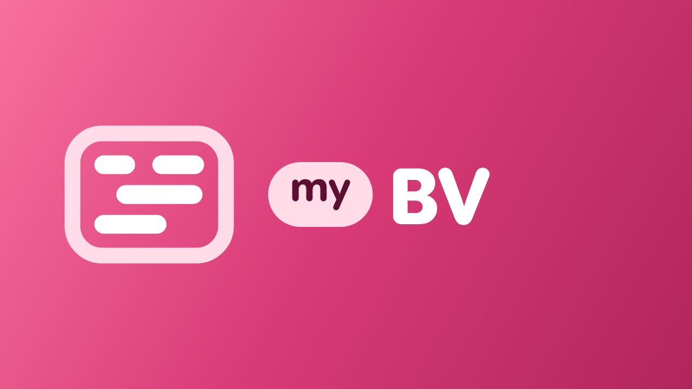

<div align="center">



# myBV

myBV 是 [BV](https://github.com/mytv-android/bv) 的后续维护版本，适配 `Android 移动端` 和 `Android TV`，使用 `Jetpack Compose` 开发。

**myBV 无法在中国大陆地区内的智能电视上使用，如有相关使用需求请使用 [云视听小电视](https://app.bilibili.com)**

**禁止在中国境内传播、宣传、分发 myBV**

</div>

---

## 界面

以下截图来自 Android 模拟器实拍，同一版本 `1.0.0.r1139`，覆盖手机、平板、电视、折叠屏与双面屏五种形态。

<table>
  <tr>
    <td align="center"><br/><sub>手机 · 1080×2400</sub></td>
  </tr>
</table>

<table>
  <tr>
    <td align="center" width="50%"><br/><sub>折叠屏 · 2208×1840</sub></td>
    <td align="center" width="50%"><br/><sub>双面屏 · 2784×1800</sub></td>
  </tr>
  <tr>
    <td align="center"><br/><sub>平板 · 2560×1600</sub></td>
    <td align="center"><br/><sub>电视 · 1920×1080</sub></td>
  </tr>
</table>

## 从旧版 BV 迁移

1. 安装 [迁移桥接版](https://github.com/mytv-android/bv/releases/latest)，覆盖安装后原有设置和登录状态会保留。
2. 安装 myBV：[Github Releases](https://github.com/mytv-android/myBV/releases/latest)。
3. 打开 myBV，按提示点击「开始迁移」；完成后即可卸载旧版 BV。

桥接版进入应用时会检查 myBV 正式版，并在 myBV 安装后提示打开迁移。
如果 myBV 与桥接版使用不同签名，构建桥接版时需要把 myBV 签名证书的 SHA-256 写入 bv 仓库变量 `MYBV_CERT_SHA256`，否则迁移会被安全校验拒绝。

## 下载

- [Github Releases](https://github.com/mytv-android/myBV/releases)

## 相关工具

推荐使用 [易用TV助手](https://github.com/pangtugg/easytv-partner) 管理配置：它收录了 myBV 及其他开源 TV 应用，可一键安装，并提供扫码遥控、文件传输、应用安装与更新等模块，方便在电视上集中管理和查看各应用的配置与使用教程，无需注册账号。

## 构建与签名

GitHub Actions 使用以下 secrets（与 myMusic 相同）：

- `SIGNING_PROPERTIES`：base64 后的 `signing.properties`，包含 `storeFile`、`storePassword`、`keyAlias`、`keyPassword`
- `SIGN_KEY`：base64 后的 keystore，解码为 `keystore.jks`
- `GOOGLE_SERVICES_JSON`（可选）：Firebase 配置

签名证书 SHA-256 可用 `apksigner verify --print-certs <apk>` 查看。桥接版与 myBV 使用同一签名时可直接迁移；使用不同签名时，把 myBV 的证书 SHA-256 设为 bv 仓库变量 `MYBV_CERT_SHA256` 后重新构建桥接版。

构建命令：

```bash
./gradlew assembleDefaultAlpha   # Alpha
./gradlew assembleDefaultRelease # 正式
```

## 参考项目与许可证

myBV 参考并改写了以下上游项目的代码，三者均使用 MIT 许可证：

- [aaa1115910/bv](https://github.com/aaa1115910/bv) — [MIT License](https://github.com/aaa1115910/bv/blob/develop/LICENSE)
- [Frost819/newBV](https://github.com/Frost819/newBV) — [MIT License](https://github.com/Frost819/newBV/blob/main/LICENSE)
- [fantasytyx/bv](https://github.com/fantasytyx/bv) — [MIT License](https://github.com/fantasytyx/bv/blob/develop/LICENSE)

各项目的版权归其原作者所有。

## License

[MIT](LICENSE) © aaa1115910
