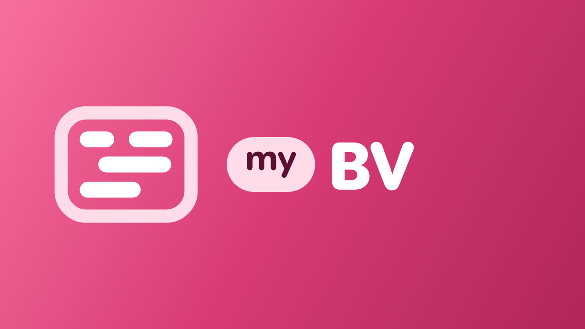

<div align="center">



# myBV

myBV 是 [BV](https://github.com/mytv-android/bv) 的后续维护版本，适配 `Android 移动端` 和 `Android TV`，使用 `Jetpack Compose` 开发。

**myBV 无法在中国大陆地区内的智能电视上使用，如有相关使用需求请使用 [云视听小电视](https://app.bilibili.com)**

**禁止在中国境内传播、宣传、分发 myBV**

</div>

---

## 从旧版 BV 迁移

1. 安装 [迁移桥接版](https://github.com/mytv-android/bv/releases/latest)，覆盖安装后原有设置和登录状态会保留。
2. 安装 myBV：[Github Releases](https://github.com/mytv-android/myBV/releases/latest)。
3. 打开 myBV，按提示点击「开始迁移」；完成后即可卸载旧版 BV。

桥接版进入应用时会检查 myBV 正式版，并在 myBV 安装后提示打开迁移。
如果 myBV 与桥接版使用不同签名，构建桥接版时需要把 myBV 签名证书的 SHA-256 写入 bv 仓库变量 `MYBV_CERT_SHA256`，否则迁移会被安全校验拒绝。

## 下载

- [Github Releases](https://github.com/mytv-android/myBV/releases)

## 构建与签名

GitHub Actions 使用以下 secrets（与 myMusic 相同）：

- `SIGNING_PROPERTIES`：base64 后的 `signing.properties`，包含 `storeFile`、`storePassword`、`keyAlias`、`keyPassword`
- `SIGN_KEY`：base64 后的 keystore，解码为 `keystore.jks`
- `GOOGLE_SERVICES_JSON`（可选）：Firebase 配置

签名证书 SHA-256 可用 `apksigner verify --print-certs <apk>` 查看。桥接版与 myBV 使用同一签名时可直接迁移；使用不同签名时，把 myBV 的证书 SHA-256 设为 bv 仓库变量 `MYBV_CERT_SHA256` 后重新构建桥接版。

构建命令：

```bash
./gradlew assembleDefaultAlpha   # Alpha
./gradlew assembleDefaultRelease # 正式
```

## License

[MIT](LICENSE) © aaa1115910
